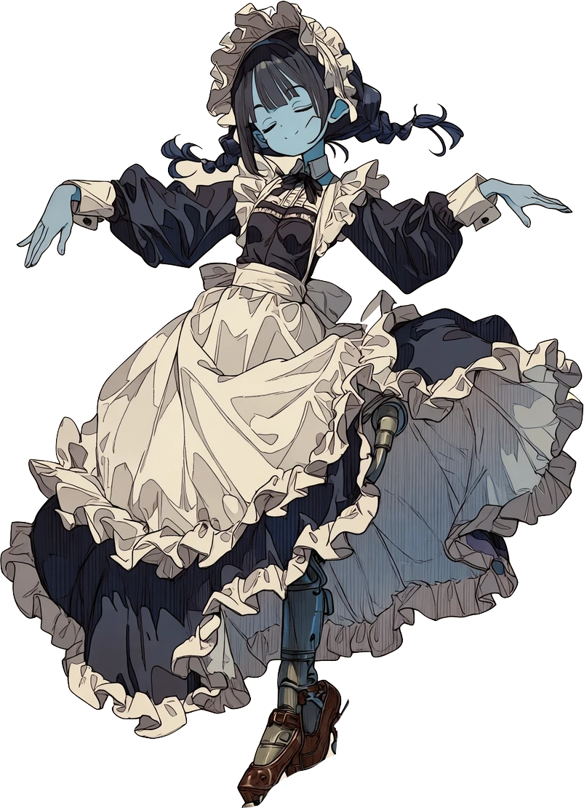

# 海城のミンネザング 設定資料（初稿）

この資料は世界観・キャラクター・トーン・音楽の基準をまとめる。**【確定】** はユーザーが決めた事項、**【案】** は検討中の提案で、採否が決まり次第書き換える。

## 1. 方向性

【確定】耽美で華やかなロマンス。参考イメージは『常夜国騎士譚RPG ドラクルージュ』（明けない夜の世界の吸血鬼の騎士たちの物語）と『プリンセス・プリンシパル』（姫を中心にした宮廷の華やかさと、登場人物それぞれの秘密やほろ苦さ）。

## 2. 世界観

### 舞台

【確定】海面が上昇し、世界の大半が海に沈んでいる。かつての山の山頂部分だけが島として点在している。

【案】
- 人々は山頂の島々に身を寄せて暮らし、島と島のあいだを行き来できるのは海城だけ。騎士は島々を守り、つなぐ存在として敬われ、同時に恐れられている。
- 島の名は、沈む前の山の名を受け継ぐ（例：「〇〇峰」）。海図には海の下の山脈や、沈んだ都の尖塔が見える。
- 第一話の舞台【案・ゲームに反映済み】：「沈みし峰々」のひとつ、ヴァルトブルク峰の沖。章題は「第一歌　血海の誓い」。ヴァルトブルクは、中世ドイツでミンネザングの歌合戦が開かれたと伝わる城の名にちなむ。ネフェリムは沈んだ谷の底から浮上し、峰の灯（島の人々の暮らし）を目指して迫る。

### 姫と海城

【確定】
- 騎士は海に浮かぶ城「海城」に乗って戦う。海城を動かしているのは、騎士にとって唯一無二の大切な存在「姫」である。
- 操作できる騎士には、それぞれ自分の姫がいる。
- 姫はもとは普通の人間（または生き物）で、その者が騎士に任じられたときの特別な儀式によって、海城の心臓部に姿を変えている。
- 姫は女性とは限らない。男性も動物もいる。

【案】
- 儀式の名は「心臓の叙任」。騎士の誓いと引き換えに、姫が海城の心臓になる。騎士の称号（〜卿）はこのときに授かる。
- **血と歌**：心臓になった姫は、血によって鼓動する。騎士が血の海から血を集める（ゲーム内の蓄血）のは、姫を生かして城を動かすため。そして騎士が姫に捧げる恋歌（ミンネザング）が、姫に人であったころの記憶をつなぎとめる。

【保留・裏設定候補】表には出さず、今は保留する。
- **代償**：歌が途絶えた姫は、自分が誰だったかを忘れ、血を求めるだけの心臓になる。そうなった海城は騎士を失っても動き続け、やがて怪物になる。
- **ネフェリム**：歌を失った海城の成れの果て。かつて誰かの姫だった心臓が、海の底で巨人の姿をとったもの。倒すことは敵を討つことであると同時に、ひとりの姫を眠らせることでもある。

【案】
- **常夜の海**：夜が明けない海。血の海が広がるほど夜は深くなる。夜が明けない理由は、物語全体の謎として後で決める。

### ゲームの仕組みとのつながり【案】

| 仕組み | 物語上の意味 |
|---|---|
| 蓄血（血域から血を吸って強化） | 姫に血を捧げ、鼓動を強める |
| 海城の耐久 | 姫の命。撃沈は姫を失うこと |
| 旗艦（ミラルカ辺境伯）の戦闘不能で撤退 | 旗艦の姫を失えば艦隊は進めない |
| スキル・カットイン | 騎士の誓いと、心臓部で応える姫の姿 |
| ネフェリムの第二形態・血潮の墜落 | 姫だったころの記憶の残り火が暴れる |

## 3. キャラクター

### 主人公

【確定】**ミラルカ・フォン・ノア**。ゲーム内の表示は **ミラルカ辺境伯**。旗艦の騎士で、プレイヤーが操作するキャラクター（試作の白鷺卿と置き換えた）。姫は **ローラ**。

- 外見（参考画像より）：銀の長髪、赤い瞳、笑うと牙がのぞく。ほつれた黒い修道女のヴェール（白い額帯つき）と黒い修道服。背後に木の十字架と棺。
- 表情：口元に挑発的な笑み。可憐さと危うさが同居する。
- 戦い方：ジョスト（助走して撃ち込む一撃）を担当する。
- 旗艦の色：銀と深紅。画面上の印（名簿・海図・ラベル）は敵の赤と紛れないよう銀。3Dの海城は深紅の船体に銀の縁取り、旗は深紅。カットインは深紅の地に白抜き。
- 姫：ローラ。貴族の娘。

【案】
- 名前の響き：「ミラルカ」は吸血鬼小説『カーミラ』の別名（ミルカーラ）に通じ、「ノア」は大洪水を方舟で生き延びた人物の名。海に沈んだ世界で海城（方舟）を駆る主人公にふさわしい。
- 修道女でありながら血を力にする騎士、という矛盾が人物の芯になる。
- 武器：十字架を巨大な杭として棺から撃ち出す。ゲーム内では、ジョストのダメージ表示を「十字架」、状態表示を「十字架を装填」「杭打ちの間合いへ」とした。
- 口調【確定】：勇ましく、ボーイッシュで幼さが残る。一人称は「ボク」、ローラは「キミ」と呼ぶ（「全艦、ボクに続け！」「勝ちは勝ち！ ……でも次は、一発で仕留めてみせるからな。」）。ローラの名を口にするときだけ、短く柔らかくなる（「……ローラ、すぐ帰るからね。」）。
- カットイン【確定】：普段の口調から一転し、凛々しく宣言する。「刻めよ、我が名を」。ミラルカのカットインに限り、この宣言を大見出しにし、技名〈ジョスト〉は小さく添える。深紅のパネルに立ち絵（参考画像の背景を除いて切り抜いたもの、`dist/art/miralka.png`）を表示する。
- 称号【案】：辺境伯は、沈んだ世界の果て、最前線の島々を預かる騎士の位。
- 後で決める：ミラルカとローラの関係（修道院で出会った、ローラの家に仕えていた、など）、ミラルカが騎士に任じられた経緯。

### 騎士・従騎士

【確定】操作できるのは、ミラルカ辺境伯（旗艦・ジョスト）、カナン卿（杭・縫い留め。主人公の補佐役）、堅牢なるオリーヴェ（盾持ちの従騎士・防護）の三人。カナン卿はオリーヴェの祖父。表示名は `battle.mjs` の `NAMES` で管理する。

#### カナン卿

【確定】老騎士。主人公ミラルカの補佐役で、オリーヴェの祖父。戦闘では杭で敵を縫い留め、失血させる（旧・茨卿の枠）。

- 外見（参考画像より）：赤と白の混じった髪、赤い瞳、白い髭。深い皺と鋭い目つき。焦げ茶の外套と襟巻き、黒い衣、籠手をはめた手を剣の柄に置く。
- 口調【案】：古風で落ち着いた武人の言葉。辺境伯を立てつつ、たしなめる（「〜ですぞ」「〜申した」、一人称「わし」）。孫のオリーヴェには短く厳しく、しかし案じる（「……オリーヴェ、前に出すぎるでないぞ。」）。
- カットイン：「老いぼれの杭、まだ錆びてはおらぬ。」。立ち絵は参考画像の上半身を切り抜いた `dist/art/kanaan.png`。
- イメージカラー【確定】：赤銅色。海城は焦げ茶の船体に赤銅の縁取り、画面上の印も赤銅色。
- 未決：姫、ミラルカ（あるいはノア家）との関係。

#### 堅牢なるオリーヴェ

【確定】盾持ちのメイドの従騎士。二つ名は「堅牢なる」。イメージカラーは青。カナン卿の孫娘（旧・赤楯卿の枠）。

- 外見（参考画像より）：青い肌、閉じた目、黒髪の三つ編み。フリルのボンネットとエプロンのメイド服。片脚が機械の義足。両腕を広げ、舞うような姿勢。
- 口調【案】：丁寧で静か（「〜でございます」、一人称「わたくし」、ミラルカを「辺境伯さま」、カナン卿を「お祖父さま」と呼ぶ）。
- カットイン：「この身が、皆さまの盾にございます。」。立ち絵は参考画像の上半身を切り抜いた `dist/art/olive.png`。
- 未決：姫（旧案の「老いた猟犬」を引き継ぐかは後で決める）、従騎士である理由。

## 4. トーン

【確定】色と装飾は次の案で進める。

- **色**：深紅・金・象牙・夜の紺。
- **装飾**：茨と薔薇の紋様、レース、金縁。
- **文字**：明朝体を基本にし、見出しや騎士名に装飾的な書体を使う。
- **言葉づかい**：宮廷風で、やや古風。説明的なシステム文言は短く保つ。

【案】
- カットインは、今の紋章表示から、騎士の立ち絵と、その背後の心臓部に浮かぶ姫の姿を重ねる演出へ発展させる。
- 海城の心臓部は、城の中央に脈打つ光として3D表示する。蓄血に応じて鼓動を速く、明るくする。

## 5. 音楽

【確定】

| 場面 | 曲調 | 編成 |
|---|---|---|
| 移動・通常戦闘 | マーチ | ホルン中心 |
| 強敵戦（ネフェリムなど） | ワルツ。第二形態で転調・加速 | 弦楽中心 |
| ドラマパート | 耽美・静か | チェンバロ、弦楽 |
| 叙任・姫にまつわる場面 | 荘厳 | 聖歌隊 |

効果音：鼓動（姫の心臓。蓄血や危機で変化）、杭が海から突き出る音、槍の射出、鐘の音（戦術ポーズ）、海と風の環境音。

## 6. 未決事項

- 騎士の性別・名前・年齢と、姫それぞれの名前
- 夜が明けない理由と、物語全体の目的
- 「心臓の叙任」の採否（「歌が途絶えた姫が怪物になる」「ネフェリム＝歌を失った海城」は裏設定候補として保留）
- ミラルカとローラの関係、ミラルカが騎士に任じられた経緯
- 第一話以降のステージ構成と、ドラマパートで姫を登場させる方法（心臓部の声、回想、夢など）
